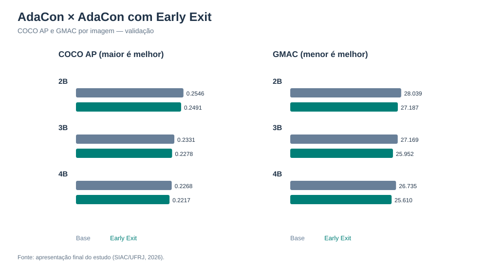
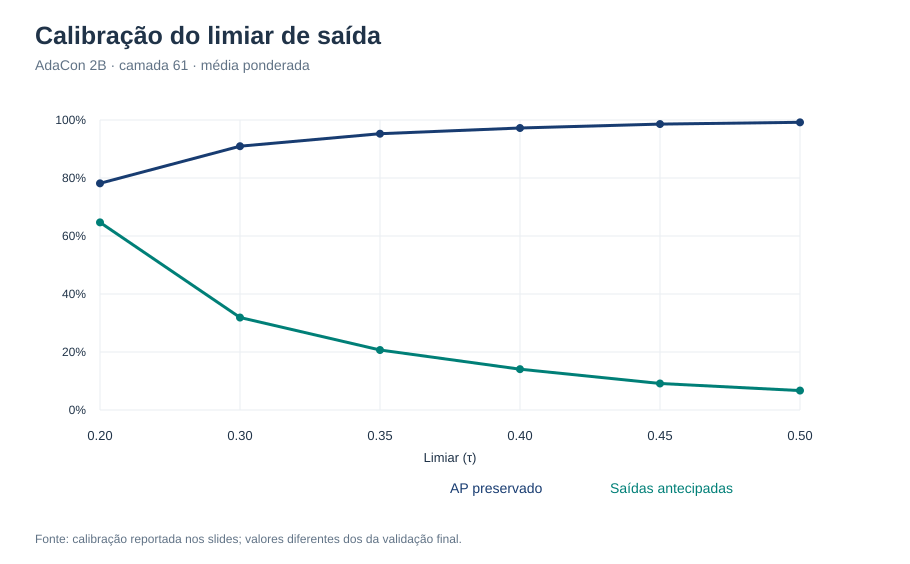

# AdaCon + Early Exit

**Saídas antecipadas em uma rede de detecção de objetos com ramos especializados.**

Projeto de iniciação científica desenvolvido no **Grupo de Teleinformática e Automação (GTA/UFRJ)**, apresentado no SIAC 2026. O estudo investiga uma pergunta prática: *é possível gastar menos computação em imagens mais simples sem comprometer muito a qualidade da detecção?*

**Pesquisador:** Pedro Cintra Silveira<br>
**Colaboração e orientação acadêmica:** Miguel Elias M. Campista e Daniel Sadoc Menasche

## Ideia do projeto

O [AdaCon](https://github.com/scale-lab/AdaCon) usa um backbone compartilhado, um controlador e ramos especializados para detectar objetos de acordo com o contexto da imagem. A pesquisa estudou a inclusão de **early exits**: pontos de decisão que permitem encerrar parte do processamento quando a predição já é suficientemente confiável.

Foram comparadas arquiteturas com **2, 3 e 4 ramos**, diferentes posições de saída (camadas 49, 52, 55, 58 e 61), critérios de confiança e limiares de aceitação. Os experimentos usaram o **COCO 2017**, com imagens de 416 × 416 pixels. A avaliação considerou **COCO AP (AP50:95)** e **GMAC por imagem** (custo estimado do caminho executado).

## Resultados

| Configuração | AP original | AP com saída | GMAC original | GMAC com saída | Redução de GMAC | Saídas antecipadas |
|:---:|---:|---:|---:|---:|---:|---:|
| 2 ramos | 0,2546 | **0,2491** | 28,039 | 27,187 | 3,04% | 14,00% |
| 3 ramos | 0,2331 | 0,2278 | 27,169 | 25,952 | **4,48%** | 20,94% |
| 4 ramos | 0,2268 | 0,2217 | 26,735 | **25,610** | 4,21% | 20,94% |

A apresentação informa os percentuais a partir dos resultados completos. Recalculá-los com o AP exibido em quatro casas decimais pode produzir diferenças de **0,01 ponto percentual** por arredondamento.

A configuração escolhida para priorizar a qualidade foi **2 ramos, saída na camada 61, média ponderada e limiar 0,40**. Ela preservou **97,83% do AP** da base e reduziu **3,04% do GMAC**. A de 3 ramos teve a maior redução relativa de custo.



O limiar cria um compromisso entre qualidade e custo: permitir mais saídas reduz as operações executadas, mas pode diminuir o AP. A figura abaixo mostra a **calibração** da configuração 2B; os valores finais da tabela acima correspondem à **validação**, por isso não são idênticos.



## Como explorar os resultados

Os scripts de análise usam apenas Python 3.9+ e a biblioteca padrão:

```bash
python scripts/validate_results.py
python scripts/plot_results.py
```

O primeiro confere os indicadores derivados das tabelas; o segundo recria as figuras SVG. Os CSVs em `results/` transcrevem os números da [apresentação final](docs/apresentacao_siac_2026.pptx). Isso permite conferir os resultados publicados sem baixar o COCO ou pesos de redes neurais.

## Estrutura

```text
Adacon_Early_Exit/
├── baseline/adacon/       # recorte do código AdaCon original
├── docs/                  # apresentação final e notas de procedência
├── figures/               # gráficos gerados a partir dos resultados
├── results/               # tabelas de comparação e calibração
├── scripts/               # validação e visualização dos resultados
├── .gitignore
└── README.md
```

O código-base de detecção e treinamento foi preservado em `baseline/adacon/` para consulta, com autoria e licença do projeto original. A implementação experimental de *early exit* e seus checkpoints **não estavam presentes no material disponível para organizar este repositório**. Portanto, o que é reproduzível aqui imediatamente são as **análises dos resultados**, e não o treinamento ou a inferência do modelo modificado. Os passos de execução da base AdaCon estão em [`baseline/adacon/README.md`](baseline/adacon/README.md).

## Limitações e próximos passos

A análise usa GMAC como estimativa de custo computacional. **Latência e consumo de energia no hardware de destino ainda precisam ser medidos.** Também vale estudar saídas mais precoces e critérios de calibração por classe ou por complexidade da cena.

## Referências e créditos

- **AdaCon (base original):** M. Neseem e S. Reda, *Adaptive Context-Aware Object Detection for Resource-Constrained Embedded Devices*, ICCAD 2021. [Código](https://github.com/scale-lab/AdaCon) · [Artigo](https://arxiv.org/abs/2108.06850).
- **Early exiting:** S. Teerapittayanon, B. McDanel e H. T. Kung, *BranchyNet: Fast Inference via Early Exiting from Deep Neural Networks*, ICPR 2016.
- **Dataset:** T.-Y. Lin et al., *Microsoft COCO: Common Objects in Context*, ECCV 2014.
- Consulte [`docs/PROVENIENCIA.md`](docs/PROVENIENCIA.md) para saber o que veio do projeto AdaCon e o que foi preparado para este portfólio.

O recorte do AdaCon mantém os créditos de origem e a licença **GPL-3.0**.
