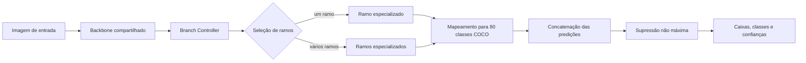

# AdaCon Early Exit

Projeto de pesquisa sobre eficiência em detecção de objetos, desenvolvido na UFRJ no contexto do Grupo de Teleinformática e Automação (GTA). O repositório reúne uma base executável do [AdaCon](https://github.com/scale-lab/AdaCon), dados consolidados de um estudo com saídas antecipadas (*early exits*) e scripts para conferir e explorar os resultados.

O objetivo é investigar como reduzir o trabalho de inferência em imagens menos complexas, preservando a qualidade da detecção. A base AdaCon seleciona ramos especializados de acordo com o contexto da cena; o estudo registrado aqui avalia saídas em uma etapa intermediária da rede.

**Tecnologias principais:** Python, PyTorch, YOLOv3, AdaCon, COCO 2017 e pycocotools.

## 🧭 Visão geral

O AdaCon é um detector adaptativo derivado de YOLOv3. Em vez de executar todos os ramos de detecção para toda imagem, um controlador estima quais grupos de classes são relevantes e ativa apenas os ramos correspondentes. O objetivo é reduzir o custo de processamento sem perder a capacidade de detectar objetos da cena.

Este repositório tem duas frentes complementares:

- **Código-base executável:** `baseline/adacon/` contém a implementação AdaCon de quatro ramos, com scripts de treinamento, inferência e avaliação do projeto original.
- **Registro da pesquisa:** `results/` reúne métricas do estudo sobre *early exit*, e `scripts/` confere as relações entre AP, GMAC e taxa de saída antecipada ou gera gráficos locais a partir desses dados.

As medições de *early exit* são úteis para análise e comparação. A implementação que produziu essas medições, seus pesos, logs e a seleção exata de imagens de calibração não estão neste recorte. Assim, o código disponível permite executar e estudar o AdaCon original, enquanto os scripts em `scripts/` permitem inspecionar os valores registrados da pesquisa.

## 🔗 Relação com o AdaCon original

O [AdaCon](https://github.com/scale-lab/AdaCon) (*Adaptive Context-Aware Object Detection for Resource-Constrained Embedded Devices*) é o trabalho de M. Neseem e S. Reda apresentado no ICCAD 2021. A arquitetura divide as classes do detector em grupos e usa um *Branch Controller* para escolher os ramos que processarão cada imagem.

O conteúdo em `baseline/adacon/` é um recorte do repositório original `scale-lab/AdaCon`, no commit `cb8b871`, preservado sob GPL-3.0. Ele inclui as configurações da arquitetura, os utilitários e as interfaces originais de treino, teste e detecção. Esses arquivos não devem ser confundidos com desenvolvimento autoral deste projeto.

O trabalho do GTA/UFRJ parte dessa arquitetura e registra uma investigação de saídas antecipadas em camadas intermediárias. As contribuições disponíveis neste repositório são a documentação técnica, a organização dos resultados em CSV, os scripts de validação e os gráficos derivados. O código da modificação experimental de *early exit* não foi recuperado junto com os materiais do estudo.

## 🧩 Arquitetura e fluxo de execução

Na configuração presente em `model.args`, o AdaCon usa um *backbone* compartilhado, um controlador e quatro ramos de detecção. Os grupos de classes são definidos em `clusters.data`; uma classe pode aparecer em mais de um grupo.



O fluxo é implementado principalmente por `adacon_model.py`, `models.py` e `detect.py`:

1. **Backbone:** extrai mapas de características compartilhados pela imagem inteira.
2. **Branch Controller:** recebe essas características e estima a relevância de cada grupo de classes.
3. **Seleção adaptativa:** em modo de ramo único, usa o grupo de maior resposta; em modo multirramos, ativa os grupos acima de `--bc-thres`.
4. **Ramos especializados:** cada ramo processa as características comuns com sua própria configuração YOLO e produz detecções para o seu conjunto de classes.
5. **Reconciliação das classes:** as saídas são mapeadas para o espaço de 80 classes do COCO, concatenadas e filtradas por *non-maximum suppression* (NMS).

### Configuração disponível

`model.args` aponta para uma arquitetura de quatro ramos. Ele usa `cfg/adacon_backbone.cfg` para o *backbone*, `cfg/adacon_branch_controller.cfg` para o controlador e `cfg/adacon_branch0v0.cfg` a `cfg/adacon_branch3v0.cfg` para os ramos. Os pesos esperados também são declarados nesse arquivo e ficam fora do Git.

| Modo | Como funciona | Onde usar |
|---|---|---|
| Multirramos | Ativa grupos acima do limiar do controlador | `detect.py` e `test.py` com `--adaptive` |
| Ramo único | Executa apenas o grupo de maior resposta | `detect.py --single` ou `test.py --single` |
| Oráculo | Executa todos os ramos como referência | `test.py --oracle` |

## 🗂️ Dataset: COCO 2017

O estudo usou o **Microsoft COCO 2017**, dataset de detecção de objetos com **80 classes** e imagens reais contendo pessoas, animais, veículos, objetos cotidianos, oclusões e diferentes escalas.

A divisão utilizada no estudo foi:

| Conjunto | Imagens | Utilização |
|:--|--:|:--|
| **Treinamento** | **113.287** | Treinamento da rede |
| **Calibração** | **5.000** | Escolha de camadas, métodos e limiares |
| **Validação** | **5.000** | Comparação final das configurações |

As imagens foram processadas em **416 × 416 pixels**. O conjunto oficial `train2017` contém 118.287 imagens; 5.000 foram reservadas para calibração e 113.287 permaneceram no treinamento. As outras 5.000 são do `val2017` oficial. O arquivo com a seleção exata de imagens de calibração não faz parte deste repositório.

Dataset e anotações: [COCO](https://cocodataset.org/#download).

## 📊 Resultados experimentais registrados

O estudo usou COCO 2017 com 113.287 imagens de treinamento, 5.000 de calibração e 5.000 de validação, processadas em 416 × 416 pixels. Foram comparadas bases AdaCon com dois, três e quatro ramos e saídas intermediárias nas camadas 49, 52, 55, 58 e 61.

As métricas são **COCO AP (AP50:95)**, **GMAC por imagem**, taxa de saída antecipada e AP preservado. Os CSVs em `results/` são uma transcrição das medições do estudo, e não uma nova execução produzida pelos scripts deste repositório. Calibração e validação são etapas distintas.

Na comparação final, a saída antecipada foi registrada na camada 58 com média ponderada como critério de confiança. O limiar foi `0,40` para 2B e `0,35` para 3B e 4B.

| Configuração | AP AdaCon | AP com saída antecipada | Redução de GMAC | Saídas antecipadas |
|---|---:|---:|---:|---:|
| 2B | 0,2546 | 0,2491 | 3,04% | 14,00% |
| 3B | 0,2331 | 0,2278 | 4,48% | 20,94% |
| 4B | 0,2268 | 0,2217 | 4,21% | 20,94% |

Os dados indicam redução de custo com retenção próxima de 98% do AP nas três configurações. A configuração 2B teve o maior AP final; 3B apresentou a maior redução relativa de GMAC; e 4B teve o menor GMAC absoluto entre os casos comparados.

Para explorar a escolha de camadas, métodos de decisão e limiares, consulte `layer_search.csv`, `gate_calibration.csv` e `threshold_calibration.csv`. A [apresentação do estudo](docs/apresentacao_siac_2026.pptx) é a fonte dos valores transcritos.

## 🛠️ Ferramentas e tecnologias

| Ferramenta | Para que foi utilizada |
|:--|:--|
| **Python** | Scripts de análise, conferência de métricas e geração de gráficos |
| **PyTorch** | Framework da implementação do detector AdaCon de referência |
| **AdaCon / YOLO** | Base do modelo de detecção com ramos especializados |
| **COCO 2017** | Imagens e anotações usadas no treinamento e na avaliação |
| **pycocotools** | Cálculo das métricas de avaliação no padrão COCO |
| **CSV e SVG** | Organização dos resultados e visualização das comparações |
| **Git e GitHub** | Versionamento e documentação do projeto |

Os scripts incluídos em `scripts/` funcionam com a **biblioteca padrão do Python**, sem instalar PyTorch ou baixar o COCO. As dependências de visão computacional entram em cena ao executar o detector original.

## ▶️ Instalação e execução

### Pré-requisitos

- Git e um ambiente Python compatível com as dependências em `baseline/adacon/requirements.txt`.
- Para o detector: PyTorch, pesos do AdaCon e uma imagem local ou o COCO 2017, conforme a tarefa.
- Para os scripts de análise: somente Python e a biblioteca padrão.
- Para os scripts de download: Bash, `wget` ou `curl` e `unzip`. No Windows, use Git Bash, WSL ou baixe os arquivos manualmente.

### Preparar a base AdaCon

```bash
git clone https://github.com/PedroCintra67/Adacon_Early_Exit.git
cd Adacon_Early_Exit/baseline/adacon
python -m venv .venv
```

Ative o ambiente virtual e instale as dependências:

```powershell
# PowerShell
.venv\Scripts\Activate.ps1
python -m pip install -r requirements.txt
```

```bash
# Linux, macOS ou Git Bash
source .venv/bin/activate
python -m pip install -r requirements.txt
```

O arquivo `model.args` declara os pesos necessários. Em Linux, macOS ou Git Bash, obtenha os pesos originais com:

```bash
bash weights/download_adacon_weights.sh
```

Para preparar o COCO na estrutura esperada pela configuração `data/coco2017.data`, execute:

```bash
bash data/get_coco2017.sh
```

Os pesos, o dataset e saídas locais são ignorados pelo Git. Os scripts de download e o ambiente legado não foram executados nesta preparação; confirme se os endereços de download ainda estão disponíveis antes de iniciar um experimento longo.

### Inferência adaptativa

A partir de `baseline/adacon/`, execute inferência em uma imagem, diretório, vídeo ou stream. O exemplo abaixo usa a configuração de quatro ramos com imagens de 416 pixels:

```bash
python detect.py --adaptive --model model.args --source caminho/para/imagem.jpg --img-size 416
```

`--bc-thres` ajusta o limiar usado para selecionar ramos no modo multirramos. `--single` força apenas o grupo com maior resposta:

```bash
python detect.py --adaptive --model model.args --source caminho/para/imagem.jpg --img-size 416 --bc-thres 0.40
python detect.py --adaptive --model model.args --source caminho/para/imagem.jpg --img-size 416 --single
```

As imagens anotadas são gravadas em `output/` por padrão.

### Avaliação e treinamento do AdaCon original

Com COCO e pesos preparados, avalie a configuração adaptativa com:

```bash
python test.py --adaptive --model model.args --data data/coco2017.data --img-size 416
```

Com `--adaptive --single`, o teste avalia o ramo mais provável; com `--adaptive --oracle`, executa todos os ramos como referência. O script também oferece `--profile`.

`train.py` expõe treinamento separado para o controlador e para cada ramo. Na configuração incluída, `--cluster_idx` aceita índices de `0` a `3`:

```bash
# Controlador de ramos
python train.py --adaptive --train_bc_only --model model.args --data data/coco2017.data --img-size 416 416 416

# Primeiro ramo especializado
python train.py --adaptive --cluster_idx 0 --model model.args --data data/coco2017.data --img-size 416 416 416
```

Esses comandos são os argumentos reais expostos pelo código-base. A implementação experimental das saídas antecipadas e seus checkpoints não estão disponíveis, portanto eles não reproduzem as métricas de *early exit* registradas abaixo.

### Consultar os resultados registrados

Na raiz do projeto, execute:

```bash
python scripts/validate_results.py
python scripts/plot_results.py
```

O primeiro mostra a redução de GMAC e o AP preservado para 2B, 3B e 4B. O segundo cria localmente `figures/model_comparison.svg` e `figures/threshold_tradeoff.svg` a partir dos CSVs. Os valores detalhados ficam em [`model_comparison.csv`](results/model_comparison.csv), [`layer_search.csv`](results/layer_search.csv), [`gate_calibration.csv`](results/gate_calibration.csv) e [`threshold_calibration.csv`](results/threshold_calibration.csv).

Esses comandos conferem e visualizam as medições registradas; não reexecutam o treinamento ou a inferência do experimento de *early exit*.

## ⚙️ Funcionalidades e extensões possíveis

Com os recursos externos preparados, o código-base permite executar detecção adaptativa em imagens, diretórios, vídeos e streams; alternar entre seleção multirramos, ramo único e oráculo; ajustar o limiar do controlador; treinar o controlador e cada ramo; e avaliar detecções no formato COCO.

O repositório também permite analisar as métricas consolidadas e gerar visualizações locais sem dependências externas. Uma extensão de *early exit* pode reutilizar o fluxo já existente ao inserir uma cabeça intermediária, definir um critério de confiança e decidir entre retornar essa saída ou continuar o processamento. Essa é uma possibilidade de extensão, não uma funcionalidade presente no código atual.

## 📁 Organização do repositório

```text
Adacon_Early_Exit/
├── baseline/
│   └── adacon/
│       ├── cfg/        # configurações do backbone, controlador e quatro ramos
│       ├── data/       # nomes das classes, configuração COCO e download do dataset
│       ├── utils/      # carregamento de dados, parsing e utilitários
│       ├── weights/    # scripts para obter pesos; pesos baixados são ignorados
│       ├── adacon_model.py
│       ├── detect.py   # inferência
│       ├── test.py     # avaliação
│       ├── train.py    # treinamento
│       └── model.args  # caminhos para arquitetura e pesos
├── docs/               # apresentação do estudo e procedência dos materiais
├── results/            # métricas consolidadas em CSV
├── scripts/            # validação e geração local de gráficos
├── .gitignore
├── LICENSE
└── README.md
```

## 📚 Referências e créditos

- M. Neseem e S. Reda, *AdaCon: Adaptive Context-Aware Object Detection for Resource-Constrained Embedded Devices*, ICCAD 2021. [Artigo](https://arxiv.org/abs/2108.06850) · [Código original](https://github.com/scale-lab/AdaCon).
- S. Teerapittayanon, B. McDanel e H. T. Kung, *BranchyNet: Fast Inference via Early Exiting from Deep Neural Networks*, ICPR 2016.
- T.-Y. Lin et al., *Microsoft COCO: Common Objects in Context*, ECCV 2014.

O recorte do código AdaCon em `baseline/adacon/` mantém sua **licença GPL-3.0** e a atribuição aos autores originais. A [documentação de procedência](docs/PROVENIENCIA.md) detalha a origem dos arquivos.
